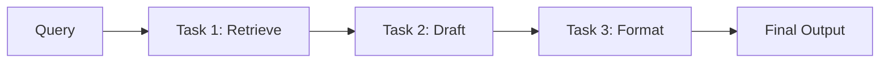
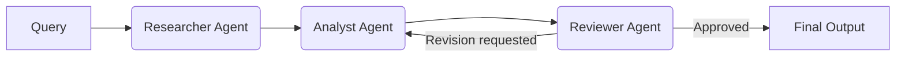
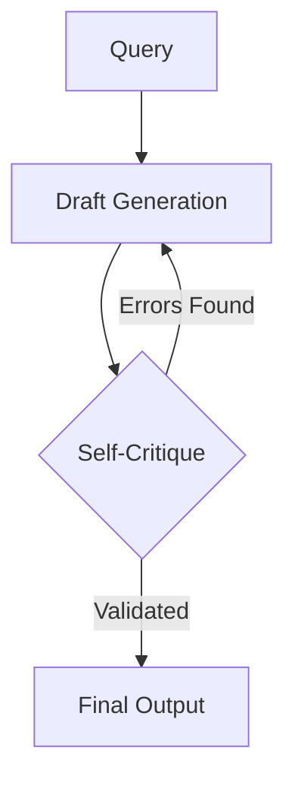
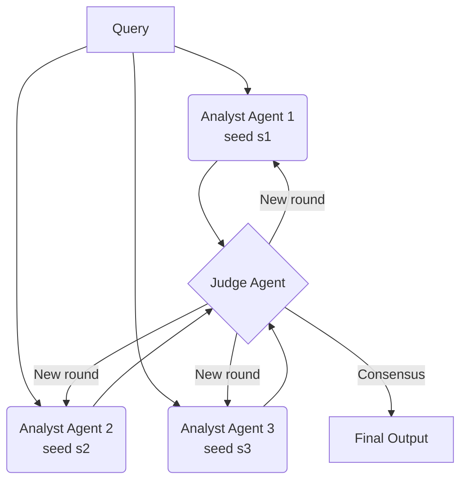

# 01. Project Description
**INESC TEC Summer Research Internship 2026**
**Evaluating Agentic AI Architectures for Critical Decision Support**
Version 2.0 (supersedes PROJECT_DESCRIPTION.md v1). Owns: motivation, research question, the four agentic patterns, division of labor, stack rationale. For datasets, base model and execution phases see `02_EXPERIMENTAL_DESIGN.md`. For all metric definitions see `03_EVALUATION_METRICS_SPECIFICATION.md`. For setup see `04_ONBOARDING_AND_SETUP.md`.

---

## 1. Introduction and Motivation

Welcome to the team! This internship forms the empirical foundation for advanced research into autonomous decision-making systems.

When deploying Large Language Models (LLMs) in high-stakes domains (defense, healthcare, finance), we encounter the **Plausibility Paradox**: models generate highly fluent and plausible prose that inadvertently hallucinates facts or omits critical structural constraints. Because the text looks so professional, human domain experts tend to over-trust it, leading to miscalibrated oversight.

To study this, we move beyond simple "chatbots" and investigate **Agentic AI Frameworks**: orchestrated systems of one or more LLM agents that plan, retrieve, and verify information before showing it to a human.

### The Foundational Papers

Your work directly synthesizes and expands upon two papers:

1. **"When to Intervene? An Agentic Framework for Uncertainty-Triggered Human-in-the-Loop"**: introduces the **Composite Score of Uncertainty, U(x)**, which aggregates several measurable components of AI uncertainty and triggers human intervention only when necessary.
2. **"The Exploration-Verification Matrix: Calibrating Agentic AI Architectures for Human-Centered Critical Decision Support"**: maps structural patterns for building multi-agent systems, balancing how freely agents explore ideas versus how strictly they verify them.

---

## 2. The Research Objective

We will **implement four distinct Agentic AI Patterns** (from the Exploration-Verification Matrix) on top of a single standardized base LLM, and evaluate all four on the same set of analytical datasets. Keeping the model and the data fixed means that any difference we observe in the uncertainty telemetry is attributable to the **orchestration pattern**, which is the object of study.

The research question:

> How does each pattern behave in relation to the Composite Score of Uncertainty? Which pattern is best at mitigating the Plausibility Paradox?

Two important methodological notes, stated here once and developed in the companion documents:

* The four patterns do not all expose the same internal signals. Patterns are therefore compared on a **shared surface score**, with pattern-specific sensors reported as diagnostic evidence. The comparison protocol is defined in `03_EVALUATION_METRICS_SPECIFICATION.md`, Section 4. This is a hypothesis-testing design: whether simpler patterns conceal their uncertainty is a question the data will answer, not an assumption of the framework.
* The choice of base model, datasets, and hardware is governed by `02_EXPERIMENTAL_DESIGN.md` and is locked before implementation starts (Phase 1).

---

## 3. The Four Agentic Patterns (Division of Labor)

Each intern implements two patterns. The pairing groups patterns by orchestration style, so each of you becomes the specialist of one "family".

### Intern 1: The Linear Pipelines

**Pattern 1. Governed Workflow**
A strict, deterministic pipeline where transitions between tasks are rigidly controlled by the system, leaving zero routing autonomy to the LLM.

**Pattern 2. Role-Separated Pipeline**
Specialized agents assume distinct roles and pass state sequentially. The Reviewer can send the draft back to the Analyst, which creates measurable revision rounds.

### Intern 2: The Deliberative Models

**Pattern 3. Reflexive Single Agent**
A single agent generates a draft, critiques its own output against the retrieved evidence, and refines it iteratively before final submission.

**Pattern 4. Multi-Perspective Deliberation**
Three **symmetric** agents generate independent analyses of the same query in parallel rounds, and a Judge agent synthesizes the debate into a verified consensus. The agents receive identical instructions; diversity comes exclusively from sampling (distinct seeds), never from assigned stances such as "Pro" and "Con". The ensemble size (K = 3) and the symmetry requirement are methodological decisions, justified in `03_EVALUATION_METRICS_SPECIFICATION.md`, Section 2.3.1, and locked in `02_EXPERIMENTAL_DESIGN.md`, Section 4.3.

> Note on numbering: patterns are numbered 1 to 4 in this order in every document and in code (`pattern_id` 1..4). Do not renumber locally.

---

## 4. What We Measure (Overview Only)

For each pattern and each dataset item, the orchestrator emits telemetry from which we compute the components of U(x). At a glance:

| Component | Intuition |
| :--- | :--- |
| u_L | Does the output respect the required structure and format? |
| u_F | Is the content factually grounded in the reference context? |
| u_C | Do parallel, symmetric agents converge on the same answer? |
| u_R | Does the reasoning stay stable across critique rounds, or drift? |
| u_P | Is the text more fluent than it is correct? (The Plausibility Paradox) |

**This table is intentionally informal.** The only canonical definitions, formulas, normalizations, and the rules for which components apply to which pattern live in `03_EVALUATION_METRICS_SPECIFICATION.md`. When implementing, code against that document, never against this table.

---

## 5. Technology Stack (Rationale)

### Implementation: Pure Python + Pydantic

> **Why are we NOT using LangChain, CrewAI, or LangGraph?**
> Contemporary frameworks predominantly conceptualize orchestration as an unbounded LLM-driven routing problem. This introduces severe risks: unconstrained execution, irrecoverable state corruption, and non-reproducible traces.
>
> Because the goal of our research is to scientifically evaluate the **deterministic control and reliability** of the orchestration layer itself, relying on abstraction-heavy frameworks would obfuscate state transitions and invalidate our experiments.
>
> We implement the patterns in **plain Python**, enforcing strict state management via **Pydantic** schemas, with a thin generalized wrapper for model calls. This guarantees full auditability of the state machine.

Environment, installs, API access and the starter template are in `04_ONBOARDING_AND_SETUP.md`. Hardware constraints and their scientific implications are in `02_EXPERIMENTAL_DESIGN.md`.
